# IntentFlow SDN

IntentFlow is a closed-loop, intent-to-configuration research framework for
Software-Defined Networks (SDNs). It converts a natural-language network
requirement into a validated structured intent, plans over the discovered
topology, compiles deterministic OpenFlow rules, deploys and verifies them
through a restricted worker boundary, measures actual network behavior, and
publishes execution evidence.

This project is intentionally different from an LLM controller that writes
OpenFlow or shell commands. A large language model (LLM) is used only to
understand a request and extract a typed intent. The deterministic backend
owns topology discovery, validation, planning, measurement, compilation,
deployment, cleanup, verification, and reporting.

## Contents

- [What IntentFlow does](#what-intentflow-does)
- [Implemented status](#implemented-status)
- [Architecture](#architecture)
- [End-to-end execution lifecycle](#end-to-end-execution-lifecycle)
- [Intent and LLM architecture](#intent-and-llm-architecture)
- [Planning and optimization](#planning-and-optimization)
- [Topology design and preview planning](#topology-design-and-preview-planning)
- [Measurement and evidence](#measurement-and-evidence)
- [Compiler and deployment](#compiler-and-deployment)
- [Frontend](#frontend)
- [Backend API and repository layout](#backend-api-and-repository-layout)
- [Security architecture](#security-architecture)
- [Technology stack](#technology-stack)
- [Installation and startup](#installation-and-startup)
- [Testing and evaluation](#testing-and-evaluation)
- [Deployment documentation](#deployment-documentation)
- [Limitations and future work](#limitations-and-future-work)
- [Documentation map](#documentation-map)

## What IntentFlow does

Traditional SDN configuration requires operators to know switch identities,
DPIDs, ports, flow-match syntax, action syntax, and the topology. IntentFlow
introduces a higher-level request boundary:

```text
"Latency between h1 and h4 must be below 50 ms"
"Provide at least 20 Mbps between h1 and h4"
"Packet loss between h1 and h4 must be below 1%"
"Minimize latency between h1 and h4"
"Maximize bandwidth subject to latency below 50 ms"
```

The system represents these requests as constraints or objectives over named
metrics. It does not treat a measured value as satisfactory merely because a
flow was accepted. Candidate and final measurements, static feasibility,
topology freshness, flow readback, and cleanup are separate pieces of
evidence.

Representative semantics:

| Example | Kind | Supported path |
|---|---|---|
| Latency `< 50 ms` | Hard constraint | Generalized constraint orchestration |
| Bandwidth `>= 20 Mbps` | Hard constraint | Generalized constraint orchestration |
| Packet loss `< 1%` | Hard constraint | Measurement and planner support depend on complete ping samples |
| Multiple constraints | Conjunction | Generalized constraint orchestration |
| Minimize latency | Optimization objective | Generalized candidate selection |
| Maximize bandwidth | Optimization objective | Generalized candidate selection |
| Minimize latency with bandwidth constraint | Constrained optimization | Generalized candidate selection |

An unsupported, ambiguous, stale, infeasible, or unverified request must not
be reported as a successful deployment.

## Implemented status

The following distinction is important:

- **Implemented and unit-tested:** deterministic models, capability
  resolution, path enumeration, constraint evaluation, candidate selection,
  physical-path compilation, deployment/readback, API auth, worker IPC,
  evidence handling and migration.
- **Mock integration:** deterministic mock natural-language parsing is
  available offline.
- **Provider integration:** OpenAI, Anthropic, Gemini, and Groq providers are
  implemented with environment-configurable credentials/models.
- **Live pipeline:** Mininet, Open vSwitch, Ryu, ping, iperf3, generalized
  constraint probes, latency orchestration, and bandwidth closed-loop
  experiments have demonstrated real execution in recorded reports.
- **Deployment review:** protected systemd units and deployment preparation
  exist as reviewed drafts, but target-host installation and service startup
  remain unverified.
- **Frontend:** all seven requested pages exist; their live/backend portions
  are explicitly connected, while illustrative dashboard values remain demo
  data.

The legacy latency and bandwidth pipelines and the generalized orchestration
share implementation concepts but are separate paths. The code explicitly
prevents an LLM or API client from supplying OpenFlow rules, shell commands,
switch configuration, or deployment decisions.

## Architecture

```mermaid
flowchart LR
    User["Operator / researcher"]
    UI["Next.js frontend<br/>App Router, React, TypeScript"]
    Auth["FastAPI authentication<br/>Bearer or HttpOnly session cookie"]
    API["FastAPI routes<br/>preview, topology, executions, WebSocket"]

    LLM["Configured mock/provider LLM"]
    Intent["Legacy/generalized structured intent"]
    Canonical["CanonicalIntent validation<br/>normalization and capability resolution"]
    WorkerIPC["Unix domain socket<br/>/run/intentflow/worker.sock"]
    Worker["Privileged root worker<br/>operation allowlist + peer-GID check"]

    Mininet["Mininet diamond topology<br/>hosts, switches, veth links"]
    Graph["TopologyGraph<br/>DPIDs, ports, hosts, capacities"]
    Topology["Topology snapshot<br/>freshness and switch state"]
    Planner["Planner<br/>DFS paths, constraints, feasibility, selection"]
    Preflight["Execution preflight<br/>snapshot and selected-candidate identity"]
    Compiler["Physical-path OpenFlow compiler"]
    Executor["Cookie-scoped deployment executor"]
    RyuREST["Ryu ofctl_rest<br/>127.0.0.1:8080"]
    RyuOFP["Ryu OpenFlow channel<br/>127.0.0.1:6653"]
    OVS["Open vSwitch<br/>software datapath"]
    Measure["Ping / iperf3 measurement"]
    Evidence["Atomic JSON + Markdown evidence<br/>persistent storage"]

    User --> UI
    UI -->|"HTTP / WebSocket"| Auth
    Auth --> API
    API -->|"natural-language preview"| LLM
    LLM --> Intent
    Intent --> Canonical
    Canonical --> API

    API -->|"typed WorkerRequest"| WorkerIPC
    WorkerIPC --> Worker
    Worker -->|"health / topology / execute"| Mininet
    Mininet --> Graph
    Graph --> Topology
    Topology --> Canonical
    Canonical --> Planner
    Planner --> Preflight
    Preflight --> Compiler
    Compiler --> Executor
    Executor -->|"REST POST/GET"| RyuREST
    Worker -->|"starts/stops Ryu"| RyuREST
    RyuREST -->|"OpenFlow REST client"| RyuOFP
    RyuOFP --> OVS
    OVS --> Mininet
    Mininet --> Measure
    Measure --> Planner
    Measure --> Evidence
    Executor --> Evidence
    Evidence -->|"execution history/detail"| API
    API -->|"status and evidence"| UI
```



The Unix socket crosses the API/worker privilege boundary. The worker/Ryu
REST/OpenFlow links are separate: the worker starts Ryu, then exchanges REST
control requests with loopback-only Ryu; Ryu communicates with Open vSwitch
through OpenFlow.

## End-to-end execution lifecycle

### 1. Frontend request

The Next.js `IntentPage` submits either natural-language text or a typed
structured intent to `/api/v1/intents/preview`. Endpoint host names are
provided separately so parsing output must match the selected source and
destination.

### 2. API access and validation

Production FastAPI accepts a bearer API token or a server-side session cookie.
Browser write requests require an allowed Origin, and production WebSockets
require an authenticated session. For local development only, operators may
explicitly enable `INTENTFLOW_AUTH_DISABLED=true` with
`INTENTFLOW_ENVIRONMENT=development` and a loopback API bind. Authentication is
enabled by default; the bypass refuses production mode and non-loopback binds.
Pydantic schemas reject unknown fields and malformed input.

### 3. Structured intent creation

Provider implementations return a `StructuredIntent`, not executable
configuration. OpenAI uses Pydantic structured output, Anthropic and Gemini
use JSON-response prompting and validate the result locally. The mock provider
is deterministic regex-based parsing, is labeled as `MOCK`, and must not be
presented as a model call.

### 4. Canonical normalization

`backend/models/intent_normalization.py` converts legacy and generalized
structured intents into a `CanonicalIntent`. Canonical models support:

- Traffic scope and optional protocol/port selectors.
- Multiple `MetricConstraint` entries.
- `GT`, `GTE`, `LT`, `LTE`, `EQ`, and `BETWEEN`.
- `MINIMIZE` or `MAXIMIZE` optimization.
- Requested actions without interpreting them as executable instructions.

Legacy execution hints identify existing legacy pipelines without changing the
canonical intent's declarative semantics.

### 5. Capability resolution

`backend/capabilities.py` reports supported, unsupported, or conditional
status for recognition, measurement, planning, and execution. Capability
resolution is topology-aware and capability-ready means only that the request
passes declared capability checks. It does not mean a deployment succeeded.

### 6. Topology acquisition and validation

The worker starts its Mininet/Ryu lifecycle and discovers the current diamond
topology. `TopologyGraph` records switch DPID/name mappings, hosts and host
attachments, physical switch ports, and configured link capacities. A
topology snapshot carries operational switch connection and port state.
Incomplete snapshots block preview eligibility and execution.

### 7. Loop-free path enumeration

`backend/planner/path_enumeration.py` uses depth-first search (DFS) with a
visited-node set to produce loop-free source-to-destination paths. Every
switch-to-switch hop retains exact physical endpoints and port pairs, so
parallel links remain distinct candidates. Host attachment connections retain
the switch-side port.

Enumeration is bounded. A result records `truncated=true` when another valid
path exists beyond the configured candidate limit. Objective ranking must
have complete enumeration and complete observations for that ranking to claim
a global optimum.

### 8. Candidate generation and static feasibility

Each exact path is assigned an identity derived from its physical links.
`physical_path_capacity_mbps()` calculates the minimum configured capacity
along its links. The distinction between static capacity and measured
performance is explicit: configured capacity is a feasibility input, not
achieved throughput.

### 9. Constraint evaluation

`backend/planner/constraint_evaluation.py` evaluates one observation against
one requirement using the declared comparison operator. Missing, stale,
invalid, failed, and not-yet-observed evidence is distinct and produces an
explicit status. Evaluation is conjunctive: satisfying one requirement does
not mask failure of another.

### 10. Candidate measurement

Generalized orchestration uses three strategy registrations:

- Latency: ping average RTT in milliseconds.
- Packet loss: ping sent/received counts normalized to a percentage.
- Bandwidth: receiver-side iperf3 throughput in Mbps.

Each measurement is bound to the exact candidate and evaluation run. Ping
packet counts are retained for packet-loss validation. Packet-loss resolution
is `10` percentage-point increments at ten packets; a `1%` threshold therefore
requires a larger sample count.

### 11. Temporary probes and selection

For generalized candidate probes, the implementation:

1. Performs probe-specific topology preflight.
2. Compiles exact physical-path rules.
3. Installs the rules under a random operation cookie.
4. Reads the installed flows back.
5. Runs the candidate measurements.
6. Deletes only cookie-owned rules.
7. Verifies cleanup or records uncertainty/failure.

Planning evidence is then combined with static feasibility and objective
ranking. A hard constraint and objective are different:

- Hard constraints determine eligibility.
- Objectives rank eligible candidates.

No candidate is selected on missing or stale required evidence.

### 12. Final execution preflight

Before final deployment, `validate_preflight()` verifies identity and
freshness between the selected candidate, planned topology snapshot, and a
fresh snapshot. It is a pure identity/freshness function and never substitutes
another candidate.

### 13. Compilation

`backend/compiler/physical_path.py` requires exact physical links rather than
switch-name sequences. It validates endpoint IP addresses and switch DPIDs,
then produces IPv4 and ARP rules for both directions. Matches contain
ingress port, EtherType, and source/destination fields. Actions contain
OUTPUT with the exact next switch port.

### 14. Deployment and worker execution

The API creates an execution ID and submits an allowlisted worker request.
The root worker creates or reuses Mininet and Ryu for the operation. The
worker does not accept arbitrary executable names, arguments, shell strings,
OpenFlow payloads, filesystem paths, or deployment commands from the API.

### 15. Ryu, OpenFlow, and OVS

Ryu's `ofctl_rest` app receives REST flow-add, flow-read, and flow-delete
requests. Ryu translates them into OpenFlow 1.3 messages. OVS stores and
executes the resulting switch rules.

### 16. Verification and final measurement

The deployment executor reads each DPID and compares normalized match fields,
priority, and ordered actions. For exact physical deployment it tracks
accepted, verified, reconciled, and uncertain outcomes. Flow readback not
matching the requested rule prevents a success claim.

The orchestration then performs final measurements and records whether
constraints remain satisfied.

### 17. Cleanup and evidence

Temporary probes are cookie-scoped and cleanup removes only operation-owned
flows. Final evidence is written atomically to JSON and Markdown. Evidence
contains stage outcomes, requested intent, topology fingerprints, candidates,
measurements, deployment/readback, cleanup, and explicit `NOT_REACHED`
markers. Evidence matching an existing execution ID is not overwritten.

### 18. API and frontend response

FastAPI exposes execution status, events, summaries, details, persisted
evidence, live/topology state, and health. The frontend consumes real API
responses while retaining clearly identified demo datasets that are not
replaced with fabricated live telemetry.

## Intent and LLM architecture

### Provider support

| Provider | Default model | Integration |
|---|---|---|
| `mock` | deterministic offline parser | Regex-based, not an LLM |
| `openai` | `gpt-4o-mini` unless overridden by `OPENAI_MODEL` | OpenAI SDK structured output |
| `anthropic` | `claude-sonnet-4-5` unless overridden by `ANTHROPIC_MODEL` | Anthropic Messages JSON parsing |
| `gemini` | `gemini-3.6-flash` unless overridden by `GEMINI_MODEL` | Gemini REST generateContent with JSON response mode |
| `groq` | `openai/gpt-oss-120b` unless overridden by `GROQ_MODEL` | Groq OpenAI-compatible chat completions with JSON response mode |

Provider credentials are environment variables: `OPENAI_API_KEY`,
`ANTHROPIC_API_KEY`, `GEMINI_API_KEY`, or `GROQ_API_KEY`. `LLM_PROVIDER`
selects the provider and defaults to `mock`. To deliberately switch from
Gemini to Groq, configure `LLM_PROVIDER=groq` and `GROQ_API_KEY` (optionally
`GROQ_MODEL`) in the local environment, then restart the backend. Providers are
not automatically failed over: each receives user prompts only when selected.
The provider/model is configurable and no provider or model is assumed for a
live deployment unless configured.

### Prompt and schema boundary

The prompt requests a `StructuredIntent` only. Provider output is validated by
Pydantic models before canonical normalization. One optimization objective can
coexist with multiple hard metric constraints; the deterministic planner
applies every hard constraint before ranking candidates. The mock provider is
also bounded to recognizable request shapes.

The LLM never:

- Generates OpenFlow or Ryu commands.
- Runs shell commands.
- Chooses physical ports or switch DPIDs.
- Writes OVS configuration.
- Deploys a network configuration.
- Overrides feasibility or capability resolution.

## Planning and optimization

### Canonical metrics

Metric metadata is centralized in
`backend/models/metric_definitions.py`. Current definitions include:

| Metric | Canonical unit | Declared range |
|---|---|---|
| `latency` | `ms` | at least zero |
| `bandwidth` | `Mbps` | at least zero |
| `packet_loss` | `%` | 0 to 100 |
| `jitter` | `ms` | at least zero, definition only |
| `availability` | `%` | 0 to 100, definition only |

Jitter and availability currently have no execution measurement or planning
implementation. Unknown metrics are not silently inferred; capability
resolution reports them unsupported.

### Hard constraints

Hard constraints use:

- `GT`: value strictly greater than target.
- `GTE`: value greater than or equal to target.
- `LT`: value strictly less than target.
- `LTE`: value less than or equal to target.
- `EQ`: equality with model-defined numeric behavior.
- `BETWEEN`: both inclusive bounds.

A requirement is satisfied only by a valid candidate-bound observation of the
declared metric. Static capacity may prove a bandwidth candidate infeasible
before measurement, but it never substitutes for achieved throughput.

### Objective selection

The generalized selector supports MINIMIZE and MAXIMIZE. It does not select an
objective unless complete measurement evidence exists and enumeration is not
truncated. MINIMIZE latency orders by measured RTT; MAXIMIZE bandwidth orders
by measured receiver throughput. Constraints are evaluated before objective
ranking.

## Topology design and preview planning

The Network Topology page supports authoring DESIGN graphs with hosts, switches,
physical switch links, explicit port numbers, optional configured capacity,
delay and loss, administrative state, and canvas positions. Definitions are
validated and stored as immutable SQLite versions. An operator must explicitly
activate a saved version before it drives intent preview. The catalog is stored
at `$XDG_STATE_HOME/intentflow/topologies.sqlite3` by default; deployments may
set `INTENTFLOW_TOPOLOGY_DB`.

The API exposes topology catalog CRUD, version history, activation, and
validated JSON import/export under `/api/v1/topologies`. When a DESIGN topology
is active, each preview reads that active version and returns its identity,
candidate paths, constraint outcomes, and deterministic selection or rejection
explanation. Changing the active version affects subsequent previews. Missing
endpoints are rejected instead of being inferred by the LLM.

For compatibility with the existing live execution path, a direct preview
request with no active DESIGN topology may invoke the worker's one-shot fixed
diamond discovery. The frontend's topology-aware preview requires an active
saved topology and does not silently populate design selectors from this
fallback. If worker discovery is unavailable, the preview explains that no
topology is available.

DESIGN planning uses configured graph properties only. A configured bottleneck
capacity is not achieved throughput, configured delay is not measured RTT, and
no network measurement is collected during preview. Missing required properties
remain UNKNOWN. A DESIGN plan is for simulation and cannot be deployed.
Saving or activating a DESIGN definition does not start Mininet or install
flows.

The current worker does not instantiate arbitrary DESIGN graphs in Mininet.
The existing `/api/v1/topology` discovery operation starts the repository's
fixed Mininet diamond, reads its topology/switch state, and tears it down; it
is not discovery of an already-running arbitrary external network and must not
be treated as a persistent MININET or LIVE active topology. Arbitrary-topology
instantiation and persistent, freshness-checked LIVE activation require further
worker/API work and integration tests.

## Measurement and evidence

### Network measurements

| Mechanism | Implementation | Meaning |
|---|---|---|
| Ping | `backend/measurement/latency.py` | RTT and packet loss from the Mininet source host |
| iperf3 | `backend/measurement/throughput.py` | Receiver throughput from source to destination |
| Static capacity | `physical_path_capacity_mbps()` | Minimum configured link bandwidth along a path |
| Ryu flow readback | `ofctl_client` / physical executor | Exact installed flow verification |

No jitter measurement is implemented. iperf3 measured throughput is distinct
from static link capacity and can be lower due to actual contention, overhead,
or configuration.

### Measurement validity

Candidate-bound observations retain:

- Observation ID and candidate ID.
- Requirement, plan and physical-path fingerprints.
- Collected timestamp and source.
- Metric, unit, status, and numeric value.
- Ping sent/received counts where packet loss applies.

Measurement freshness and completeness are enforced separately by the planner
and preflight contracts.

### Persistent evidence

The evidence writer creates:

- JSON under `evaluation/results/generalized_*_<execution_id>.json`.
- Markdown under `docs/reports/generalized_*_<execution_id>.md`.
- Legacy CLI experiment JSON under `evaluation/results/run_<integer>.json`.

Those are backward-compatible defaults. Protected service environments set
`INTENTFLOW_EVIDENCE_JSON_DIR` and `INTENTFLOW_EVIDENCE_MARKDOWN_DIR` to
root-owned `/var/lib/intentflow` directories; no release symlinks are needed.
Files are atomically published without replacement as `0640`, directories
must be real `2750` directories, and ownership is `root:intentflow-api`. The
API reads evidence but does not write it.

## Compiler and deployment

`backend/compiler/physical_path.py` compiles exact physical paths. A switch
sequence alone is ambiguous when parallel links exist. The compiler uses:

- Switch names to positive integer DPIDs.
- Exact ingress and egress switch ports.
- Host attachment and switch-link identities.
- IPv4 source/destination and ARP source/destination.
- Priority 100 by default.
- One OUTPUT action to the next physical port.
- A bidirectional rule set.

Deployment:

- Pre-reads DPID flow state.
- Allocates a random 64-bit operation cookie.
- Adds IPv4 and ARP rules in forward and reverse directions.
- Reads flow tables back for exact match/action verification.
- Reports SUCCEEDED, PARTIAL, FAILED, or UNCERTAIN.
- Deletes only cookie-matching flows during cleanup.
- Re-reads flows after cleanup.

Timeout and ambiguous transport responses do not become automatic success.
Readback reconciles uncertain responses, while unresolved readback remains
UNCERTAIN.

## Frontend

The frontend is Next.js 16 with React 19, TypeScript, Tailwind CSS 4, Lucide
icons, Recharts, and React Flow. It uses the App Router and API credentials
with `credentials: "include"`.

The seven pages are:

1. Overview.
2. Network topology.
3. Intent management.
4. Path planning.
5. Network metrics.
6. Execution history.
7. System configuration.

The API client calls FastAPI when `NEXT_PUBLIC_API_BASE_URL` is configured.
If the API is unavailable, the UI may enter demo mode. Demo metrics,
candidates, and execution records are stored in `frontend/src/lib/demo-data.ts`
and are never represented as live telemetry by the backend integration.

## Backend API and repository layout

The main routes include:

| Route | Purpose |
|---|---|
| `POST /api/v1/auth/session` | Exchange bearer token for HttpOnly session cookie (production); a no-op in the development bypass |
| `DELETE /api/v1/auth/session` | Revoke the current session |
| `GET /api/v1/health` | API/worker/Ryu availability |
| `GET /api/v1/topology` | Live worker topology snapshot |
| `POST /api/v1/intents/preview` | Parse/normalize, resolve capabilities and preview eligibility |
| `POST /api/v1/executions` | Start supported execution |
| `GET /api/v1/executions` | Read persisted execution summaries |
| `GET /api/v1/executions/{id}` | Read execution detail/evidence |
| `GET /api/v1/executions/{id}/status` | Read in-memory execution status and event history |
| `WebSocket /api/v1/executions/{id}/events` | Authenticated event stream in production; same-origin stream in the loopback-only development bypass |

```text
backend/
  api/                 FastAPI, auth, schemas, worker IPC, worker implementation
  compiler/            Physical-path and rate-limit flow compilation
  deployment/          Ryu REST client and operation-scoped OpenFlow deployment
  execution/           Preflight and freshness contracts
  llm/                 Provider factory, prompt, schemas, mock/provider clients
  measurement/         Ping and iperf3 measurement parsers
  models/              Intents, topology, flows, evidence and deployment models
  orchestration/       Generalized latency/constraint lifecycle and evidence
  planner/             DFS enumeration, constraints, observations and selection
  testbed/             Mininet topology and network setup
frontend/
  src/app/             Next.js route entry
  src/components/      Seven dashboard pages and UI components
  src/lib/             API client and demo data
  src/hooks/           Backend health and UI integration hooks
scripts/
  setup_system.sh      OS package and OVS setup
  setup_ryu_venv.sh    Pinned/patched Ryu 4.34 installation
  migrate_evidence.py  Non-destructive evidence migration
testbed/
  topology/diamond.py  Four-host diamond topology
evaluation/
  run_evaluation.py    Repeated baseline/closed-loop evaluation harness
  run_generalized_constraints.py
tests/                 Backend, API, planner, compiler, security and migration tests
docs/                  ADRs, reports, research results and deployment docs
```

## Security architecture

Implemented controls:

- Production FastAPI authenticates with a high-entropy API token exchanged
  into a server-side in-memory session. Authentication is disabled only by an
  explicit development-only opt-in validated against a loopback bind.
- Session cookies are HttpOnly, `SameSite=Strict`, with Secure-cookie support
  for HTTPS.
- Cookie-authenticated writes validate an allowlisted Origin.
- WebSocket authorization is tested and loopback-only service assumptions are
  documented.
- FastAPI refuses to run as root.
- FastAPI connects to a Unix-domain worker socket instead of executing user
  commands.
- The worker runs root, checks peer credentials, holds an OS lock, and
  allowlists `health`, `topology`, and `execute`.
- Worker socket paths are validated, stale sockets are reconciled safely, and
  only the socket inode owned by the worker is unlinked on shutdown.
- Ryu and API listeners are constrained to loopback in the implementation.
- Deployment flows use random operation cookies and cleanup deletes only those
  cookie-owned entries.
- Evidence files use atomic rename with ownership/mode applied before publish.
- Application and Ryu dependency locks are validated and installed with
  SHA-256 hashes.

Deployment-only controls include protected `/opt` ownership, dedicated
`intentflow-api` accounts, `/var/lib/intentflow`, `/run/intentflow`, and
systemd sandboxing. Those settings require target-host validation and do not
prove a live deployment is secured or operational.

## Technology stack

| Technology | Purpose | Where used |
|---|---|---|
| Python 3 | Main backend, planning, orchestration | `backend/`, `scripts/`, `tests/` |
| FastAPI / Uvicorn | Authenticated local API | `backend/api/main.py` |
| Pydantic v2 | Typed models, intent/schema validation | `backend/models/`, `backend/api/schemas.py` |
| Next.js 16 / React 19 | Dashboard UI | `frontend/` |
| TypeScript 5 | Frontend type safety | `frontend/src/` |
| Tailwind CSS 4 | UI styling | `frontend/` |
| Recharts / React Flow | Metric and topology visualizations | `frontend/src/components/` |
| Ryu 4.34 | OpenFlow controller and REST API | `.venv-ryu/`, worker startup |
| Open vSwitch / OpenFlow 1.3 | Dataplane flow execution | Testbed and deployment |
| Mininet | Linux network namespace testbed | `testbed/topology/diamond.py` |
| iperf3 | Receiver-side TCP throughput | `backend/measurement/throughput.py` |
| ping / iputils | RTT and packet-loss measurement | `backend/measurement/latency.py` |
| Unix domain sockets | API-to-worker privileged boundary | `backend/api/worker.py` |
| Pytest | Backend and migration regression testing | `tests/` |
| OpenAI SDK / REST APIs | Optional structured intent providers | `backend/llm/` |

| Algorithm/protocol | Purpose |
|---|---|
| DFS loop-free enumeration | Exact physical candidate path discovery |
| Fingerprint hashing | Model, topology, candidate and snapshot identity |
| Hard constraint conjunction | Reject measured/static infeasibility |
| Deterministic objective ranking | Minimize or maximize measured metrics |
| Operation-cookie ownership | Isolate and clean up deployed flows |
| OpenFlow 1.3 exact-flow readback | Verify installed physical paths |
| Atomic rename/fsync | Durable evidence publication |
| Peer credential and file descriptor locks | Protect worker IPC ownership |

## Installation and startup

### System prerequisites

The project requires Linux. Typical OS prerequisites are iproute2, Mininet,
Open vSwitch, iperf3, iputils-ping, ethtool, and tcpdump.

`scripts/setup_system.sh` performs these OS installations and starts OVS; it
requires root and is not part of documentation validation.

### Application dependencies

The hash-locked application graph is installed with:

```bash
python3 scripts/validate_dependency_locks.py
python3 -m pip install --break-system-packages --require-hashes \
  --only-binary=:all: -r requirements.txt
```

Application dependencies remain compatible with the host Mininet Python API.
This is not a self-contained Mininet installation; OS-managed Mininet/OVS
packages must remain visible.

### Ryu dependency and source setup

Run this unprivileged, not with sudo:

```bash
bash scripts/setup_ryu_venv.sh
```

The script validates dependency locks, creates `.venv-ryu`, downloads the
verified Ryu 4.34 archive, applies compatibility patches, and runs temporary
loopback verification. It preserves the existing Ryu environment rather than
upgrading dependencies broadly.

### Frontend

```bash
cd frontend
npm install
npm run dev
```

Configure `.env.local` from:

```dotenv
NEXT_PUBLIC_API_BASE_URL=http://localhost:8000
NEXT_PUBLIC_INTENTFLOW_AUTH_DISABLED=true
```

Use consistent `localhost` or `127.0.0.1` spelling across browser origin,
API URL, and CORS origins. The frontend bypass setting is for local
development only and must be unset or `false` for a protected deployment.

### API and worker

Development startup requires separate privilege and should only be reproduced
from a protected target or authorized test host:

```bash
# Worker host: review-only deployment prerequisite, privileged execution only
/opt/intentflow-sdn/.venv-app/bin/python -m backend.api.worker

# API host: unprivileged account
INTENTFLOW_API_HOST=127.0.0.1 \
INTENTFLOW_API_PORT=8000 \
/opt/intentflow-sdn/.venv-app/bin/python -m backend.api.main
```

Do not start Mininet, Ryu, OVS flows, the worker, or services from this
documentation-only review environment.

### Live demo and evaluation

Live examples require Mininet/OVS/Ryu and sudo because network namespaces and
bridges need privilege. The protected worker design is preferred over running
the entire API as root.

Recorded generalized scenarios include:

```bash
sudo mn -c
sudo PYTHONPATH=. python3 evaluation/run_generalized_constraints.py bandwidth
sudo mn -c
sudo PYTHONPATH=. python3 evaluation/run_generalized_constraints.py latency
sudo mn -c
sudo PYTHONPATH=. python3 evaluation/run_generalized_constraints.py combined
sudo mn -c
sudo PYTHONPATH=. python3 evaluation/run_generalized_constraints.py minimize-latency
sudo mn -c
sudo PYTHONPATH=. python3 evaluation/run_generalized_constraints.py maximize-bandwidth
```

These are live-network procedures and were not executed during documentation
creation.

### Validation commands

```bash
python3 scripts/validate_dependency_locks.py
python3 -m compileall -q backend scripts tests
pytest -q

cd frontend
npx tsc --noEmit
npm run lint
npm run build
```

## Testing and evaluation

The latest recorded backend regression state is 690 passing tests, including
the 10 migration regression tests. This does not prove live reliability and
does not represent Ryu/Mininet operations unless separately executed.

Coverage categories include:

- Canonical intents, normalization, fixed enums and arbitrary constrained
  metrics.
- Capability resolution and unsupported actions.
- DFS path enumeration and parallel links.
- Constraint comparison, freshness and infeasibility.
- Candidate selection and objective ranking.
- OpenFlow compilation and exact flow readback.
- Deployment retry, timeout, ambiguity, cleanup and partial outcomes.
- Worker authorization, locking, stale/live sockets and evidence permissions.
- API validation, authentication, session expiration/revocation/WebSockets.
- Evidence migration conflicts, symlinks, partial-copy and permissions.
- Dependency locks and source checksum validation.
- Evaluation aggregation and report build behavior.

Recorded live demonstrations include latency, bandwidth, closed-loop
correction, and generalized constraint runs under the repository's diamond
topology. Reports and raw artifacts distinguish real measurements from
illustrative frontend data.

See:

- `docs/experiments.md`
- `docs/final_report.md`
- `docs/final_results.md`
- `docs/final_results_table.md`
- `docs/reports/first_live_latency_demo.md`

## Deployment documentation

Deployment remains review-only until target-host validation. The proposed
layout is:

```text
/opt/intentflow-sdn       root-owned application release
/var/lib/intentflow       root-owned persistent evidence, API-readable
/run/intentflow           worker socket and lock runtime state
```

The API runs unprivileged and loopback-only. The worker is root and owns
privileged Mininet/OVS/Ryu operations. Systemd drafts are in:

- `deploy/systemd/intentflow-worker.service`
- `deploy/systemd/intentflow-api.service`
- `deploy/systemd/intentflow-api.env.example`
- `deploy/systemd/intentflow-worker.env.example`
- `docs/systemd-deployment.md`
- `docs/api-adapter.md`

Target-host validation is still required for Mininet capabilities, OVS service
names, mount restrictions, evidence directory permissions, numeric GIDs,
systemd directives, and listener ownership.

## Limitations and future work

### Implemented limitations

- The mock parser recognizes a fixed set of request forms; it is not a
  general research-grade language parser.
- `tests/data/mock_intent_cases.json` is a deterministic offline regression
  corpus. Its pass rate measures coverage of those documented mock-parser
  forms only; it is not a measure of general language understanding or of any
  remote provider's accuracy.
- Jitter and availability are metric definitions only, without measurement,
  planning, or execution support.
- Packet-loss resolution depends on ping packet count.
- Objective ranking requires complete enumeration and valid evidence.
- Concurrent API execution is limited; worker operations are serialized.
- API sessions are in-memory and invalidated by API restart.
- Ryu setup and deployment remain Linux/Mininet/OVS-specific.
- Application dependencies rely on host Mininet packages through the system
  Python/API dependency boundary.
- Deployment/systemd protection has not been target-host-live-verified.

### Future work

Plausible future extensions include additional metric strategies, unit
conversion registries, action capability registration, more robust distributed
session storage, distributed topology discovery, and expanded Ryu/OVS
telemetry. These require explicit implementation and validation rather than
being assumed from this README.

## Documentation map

- Architecture decisions: `docs/adr-001-environment-constraints.md` through
  `docs/adr-013-generalized-candidate-selection.md`
- API, worker and deployment: `docs/api-adapter.md`
- Protected systemd review: `docs/systemd-deployment.md`
- Live experiments: `docs/experiments.md`
- Final research reports: `docs/final_report.md`,
  `docs/final_results.md`, and `docs/final_results_table.md`
- Dependency setup: `scripts/setup_system.sh`,
  `scripts/setup_ryu_venv.sh`,
  `scripts/validate_dependency_locks.py`
- Migration utility: `scripts/migrate_evidence.py`
