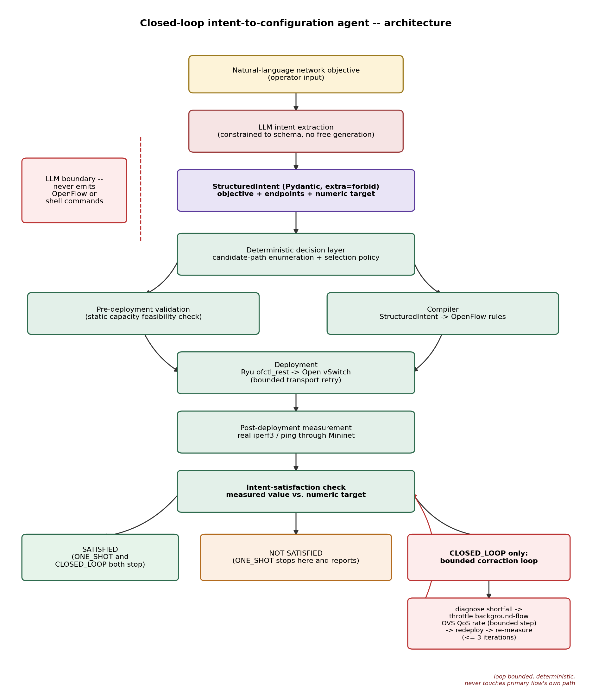

# LLM-Based Closed-Loop Intent-to-Configuration Agent for Software-Defined Networks

Semester research project. All results in this report are measured
against a real Mininet + Open vSwitch + Ryu testbed; no measurement is
simulated, estimated, or fabricated. See `docs/final_results_table.md` for
the underlying numbers and `evaluation/results/final/` for the exact files
they are drawn from.

## Abstract

Operators express network intent in natural language ("give host A to
host B the lowest-latency path", "guarantee at least N Mbps between two
hosts"), but network devices only accept precise, low-level
configuration. This project builds and evaluates a closed-loop agent that
bridges that gap without letting a language model touch the network
directly. A large language model extracts a strictly schema-validated
`StructuredIntent` from the operator's sentence; a deterministic decision
layer, compiler, and validator are the only components that ever produce
or check OpenFlow rules; a deployment layer pushes those rules to Open
vSwitch through a Ryu controller; and a measurement layer takes a real
throughput or latency reading and checks it against the stated intent. For
bandwidth objectives, when that measurement falls short, a bounded,
deterministic correction loop diagnoses the shortfall and throttles a
real competing background flow, then redeploys and re-measures, up to a
fixed iteration limit. We compare this closed-loop strategy against a
one-shot baseline (measure once, stop) across four bandwidth scenarios
spanning a feasible target, a noisy contention boundary, a target that is
sometimes correctable, and a genuinely infeasible target, using 27
completed real evaluation runs plus 11 hand-run capability
demonstrations. The measured result is precise rather than favorable to
either method: across the systematic sweep, closed-loop correction
produced no measured improvement in satisfaction rate in any of the four
scenarios, because the sweep's own samples either succeeded immediately in
both modes or were never topologically correctable at all. The one
manual demonstration where the loop had a genuine reachable shortfall to
correct converged in one iteration; a second manual run at the same
decision boundary exhausted all three permitted iterations without
converging, because the real correction step was smaller than the
testbed's own measurement noise there. Both outcomes, and the harness
reliability issues found while collecting them, are reported without
adjustment.

## Introduction

Software-defined networking (SDN) separates the control plane from
network hardware, letting a centralized controller (here, Ryu) install
forwarding rules on switches (here, Open vSwitch) through a standard
protocol (OpenFlow). This makes network behavior programmable, but the
program is still written in terms of flow-table entries, match fields,
and priorities, not in terms of what an operator actually wants ("host A
should reach host B with low latency"). Large language models are
increasingly proposed as a natural-language front end for this kind of
system administration task, but handing a language model direct write
access to network state is a correctness and safety risk: language models
are not guaranteed to produce valid, minimal, or even syntactically
correct configuration, and a single bad rule can black-hole traffic or
open an unintended path.

This project's central design decision is to keep the language model
confined to one job, extracting a structured, schema-validated
representation of intent, and to make every step from that representation
to deployed configuration deterministic, validated, and measured. The
project further asks whether closing the loop with a real post-deployment
measurement, and reacting to it with a small, bounded, non-LLM correction
mechanism, measurably improves whether the stated intent is actually met
by the live network, as opposed to just being met at first improvement
attempt.

## Problem formulation

Given a natural-language objective referring to two hosts in a fixed
topology and, optionally, a numeric performance target, produce and
deploy an OpenFlow configuration such that the live network's measured
behavior between those hosts satisfies the objective, and report a
verdict (`SATISFIED` / `NOT SATISFIED`) based on a real measurement taken
after deployment, never on the configuration's intended behavior. Two
objective types are supported: `MINIMIZE_LATENCY` (pick and deploy the
path with the lowest measured round-trip time between two candidate
paths) and `MIN_BANDWIDTH` (deploy a path guaranteeing at least a stated
throughput, in the presence of real competing background traffic). The
system must never let its language-understanding component emit
executable configuration directly, must validate every candidate before
deployment against static, known infeasibility (a path whose link
capacity cannot reach the target, regardless of contention, should never
be deployed and measured), and must report failure honestly when the
live network cannot be made to meet the target, rather than silently
lowering the bar or fabricating a passing measurement.

## Motivation

Two properties motivate closing the loop rather than stopping after a
single configuration attempt. First, real networks are not static:
background contention, scheduling jitter, and measurement noise mean that
a configuration computed to be correct can still measure short of target
at deployment time, and a configuration that measures short once can
measure fine on a later, otherwise identical attempt (this project's own
testbed demonstrates both directions -- see Results). Second, one of the
two objectives studied (`MIN_BANDWIDTH`) has a real, actionable lever
available after the fact: a competing background flow's rate can be
throttled down without touching the primary flow's own path, which is
exactly the kind of corrective action a closed-loop controller could take
autonomously instead of requiring an operator to re-run the whole
decision process by hand. This project treats "does closing the loop
actually help" as an empirical question to measure, not an assumption to
build a system around and declare successful regardless of what the
measurements show.

## Related work

The separation of a programmable control plane from switching hardware
follows the OpenFlow model (McKeown et al., "OpenFlow: Enabling
Innovation in Campus Networks," 2008) and the broader SDN research line
it started, including early declarative and policy-based controller
frameworks such as Frenetic (Foster et al., 2011) and Ethane (Casado et
al., 2007), and production-scale SDN deployments such as Google's B4
wide-area network (Jain et al., 2013). Closed-loop, verified network
control is not itself a new idea: Kinetic (Kim et al., "Kinetic:
Verifiable Dynamic Network Control," NSDI 2015) proposes a finite-state-
machine model for dynamic, verifiable network policy changes in response
to events, which is conceptually close to this project's own bounded
correction loop, though Kinetic's triggers are network events rather than
a numeric measurement shortfall. Intent-based networking, the broader
industry and research framing this project sits inside (an operator
states a desired outcome rather than a mechanism), has been surveyed
extensively in both vendor and academic literature; this project takes a
narrow, concrete instantiation of it (two objective types, a fixed
topology) rather than a general intent language. Using a large language
model specifically as a natural-language-to-structured-intent translator,
with all execution kept outside the model, follows the same "language
model proposes, deterministic system disposes" pattern increasingly used
in LLM-agent tool-use designs generally, applied here to a domain (live
network configuration) where an incorrect action has an immediate,
observable, and potentially disruptive real-world effect. Combining LLMs
directly with SDN intent translation is an active but still nascent
research area as of this writing; this project's contribution is not a
new LLM technique but a concrete, measured system boundary between
language understanding and network execution, and an honest empirical
account of whether its one closed-loop correction mechanism helps.

## Proposed architecture

The system is a strict pipeline with one conditional branch:

natural-language objective -> LLM intent extraction -> `StructuredIntent`
-> deterministic decision layer -> (pre-deployment validation, compiler)
-> deployment -> post-deployment measurement -> intent-satisfaction check
-> (`ONE_SHOT`: stop and report) or (`CLOSED_LOOP`, only if not satisfied:
bounded correction loop, then stop and report).

Every arrow in that pipeline after `StructuredIntent` is deterministic
code with no language-model involvement. The two configuration
strategies compared in this report (`ONE_SHOT`, `CLOSED_LOOP`) differ in
exactly one place: whether the correction loop is permitted to run after
the first real measurement.

### LLM role and structured intent representation

The language model's only output is a `StructuredIntent`
(`backend/models/intent.py`), a Pydantic v2 model with `extra="forbid"`
and a post-validation check (`model_validator(mode="after")`) that
rejects any object that does not match one of the two supported
objectives with the fields that objective requires (source and
destination hosts always; a numeric `target_mbps` field, itself
validated as a positive number, for `MIN_BANDWIDTH`). The model cannot
express an OpenFlow rule, a shell command, a switch name, or any field
outside this fixed schema; a malformed or out-of-schema LLM response is
rejected by Pydantic before it reaches any other part of the system,
never coerced into something usable. This is the single hard boundary
the whole design is built around: no downstream component ever executes
anything the LLM produced directly, only this schema-checked, narrow
data object.

### Deterministic decision layer

Given a validated `StructuredIntent`, the decision layer
(`backend/decision/`) enumerates the fixed set of physically possible
paths between the two named hosts in the live topology graph and applies
a selection policy specific to the objective. For `MINIMIZE_LATENCY`,
every candidate is deployed and measured (real `ping`), and the
lowest-measured-RTT candidate is selected. For `MIN_BANDWIDTH`, every
candidate is first checked against a static, no-measurement-needed
capacity bound (see Pre-deployment validation below); among candidates
that pass, each is deployed and measured with real `iperf3` under real
background contention, and the selection policy (`select_bandwidth_path`)
prefers the cheapest candidate that already meets the numeric target,
falling back to the highest-measured-throughput candidate only when none
meets it. This specific policy choice, preferring "cheapest that meets
target" over "always pick the fastest," is what makes the correction
loop's only lever (throttling a background flow that shares a link with
one specific candidate path) ever able to affect which path gets
selected in the first place; an earlier "always pick highest measured
throughput" policy meant the uncontended path was always chosen and the
correction mechanism could never have an observable effect (see ADR-006).

### SDN compilation and deployment

A deterministic compiler (`backend/compiler/`) turns the selected
candidate path into a concrete sequence of OpenFlow13 flow-mod messages
(OXM match fields, per-switch, per-hop) with no branching on
LLM-provided data beyond the already-validated `StructuredIntent`. These
are deployed to the live Ryu controller's `ofctl_rest` REST API
(`backend/deployment/ofctl_client.py`), which pushes them into each
switch's flow table over OpenFlow to the real Open vSwitch instances in
the Mininet topology. Deployment includes a bounded transport-level retry
(2 retries, short delay) for transient REST stalls under sustained load,
added after this exact failure mode was found running the evaluation
harness (see Limitations and ADR-007); an HTTP-level rejection is never
retried, only a transport-layer timeout or connection failure.

### Pre-deployment validation

Before any candidate is deployed for measurement, `MIN_BANDWIDTH`
candidates are checked against each path's static link capacity (the
`TCLink(bw=...)` value configured in the topology, not a measurement): a
path whose narrowest link is below the requested target is rejected
outright, before deployment, because no amount of contention-driven
correction can ever raise a link's hard bandwidth cap. This is a purely
static, deterministic check with no learned or LLM-derived component; its
purpose is to keep an infeasible candidate off the network entirely
rather than discovering its infeasibility empirically every time.

### Post-deployment measurement

After deployment, the system takes one real measurement per candidate
(during decision-layer evaluation) and one final real measurement on the
selected, redeployed path: `ping` (parsed real RTT and packet loss) for
`MINIMIZE_LATENCY`, `iperf3` (parsed real achieved throughput) for
`MIN_BANDWIDTH`. No measurement is ever estimated from the requested
target, the static link capacity, or a prior run; every number that
appears in a result file is the literal output of a real client/server
process running inside the Mininet network namespaces.

### Closed-loop correction algorithm

For `MIN_BANDWIDTH` only, when the final real measurement on the selected
path falls short of the target, `CLOSED_LOOP` mode runs a bounded
correction loop (`backend/pipeline/bandwidth.py`, `backend/models/feedback.py`):

1. Compute the real shortfall (target minus last measured throughput).
2. Compute a new, lower background-flow rate cap
   (`next_background_rate_mbps`), proportional to the shortfall and
   bounded below by `MIN_BACKGROUND_RATE_MBPS` (1.0 Mbps) so the
   background flow is never driven to zero.
3. Redeploy that new rate as a real OVS QoS `linux-htb` queue on the
   background flow's egress interface (never on the primary flow's own
   path or rate; `MIN_BANDWIDTH` is a floor for the primary flow, and the
   background flow is the only thing this mechanism is permitted to
   touch).
4. Re-measure the primary flow with a fresh real `iperf3` run.
5. Stop as soon as satisfied, or after `MAX_CORRECTION_ITERATIONS` (3)
   attempts, whichever comes first.

The loop is bounded, deterministic, and involves no LLM call at any
point; every iteration's rate change, redeploy, and re-measurement is a
real action against the live testbed, recorded in `correction_history` and
`background_rate_changes_mbps`.

## Experimental setup

- **Topology** (`testbed/topology/diamond.py`): 4 hosts, a diamond of 4-5
  switches, OpenFlow13, Open vSwitch userspace (`netdev`) datapath (see
  ADR-001 for why not the kernel datapath in this sandbox). Path A
  (`h1-s1-s2-s4-h4`, 10 Mbps `TCLink`) shares its `s2-s4` hop with a
  continuous real background flow `h2->h3`; Path B
  (`h1-s1-s3-s5-s4-h4`, 50 Mbps `TCLink`) shares no link with the
  background flow. Checksum/segmentation offload is disabled on every
  host veth interface, without which real TCP silently fails through this
  kernel's software OVS datapath (ADR-005).
- **Controller**: Ryu 4.34, patched to install on this sandbox's Python
  toolchain (ADR-002), run in its own virtualenv (`.venv-ryu/`),
  `ryu.app.ofctl_rest`.
- **Background traffic**: `h2->h3`, real, continuous, initially
  rate-limited to 8 Mbps via a real OVS QoS `linux-htb` queue
  (independently verified: `ovs-vsctl` shows the queue actually attached,
  and a real, independent `iperf3` measurement of that flow achieves
  ~5.2-5.45 Mbps, below its own configured cap, confirming "configured"
  and "achieved" are not conflated anywhere in this project).
- **Measurement tools**: real `ping` (latency), real `iperf3` (bandwidth),
  both invoked through Mininet host shells and parsed from real process
  output.
- **Evaluation harness** (`evaluation/run_evaluation.py`): drives both
  configuration strategies through the identical shared pipeline
  (`backend/pipeline/bandwidth.py`) across four scenarios, several
  repetitions each, with a 45-second per-run wall-clock budget; a run
  that exceeds it is recorded as an infrastructure error, never as a
  measured outcome (see Limitations).
- **Scenarios**:

  | Scenario | Target | Rationale |
  |---|---|---|
  | `feasible` | 20 Mbps | Comfortably within Path B's uncontended capacity. |
  | `boundary` | 5.15 Mbps | At Path A's real measured ceiling under contention; genuinely noisy run to run. |
  | `correctable` | 5.05 Mbps | The exact target that produced both a genuine correction success and a genuine correction failure in the manual runs. |
  | `infeasible` | 49 Mbps | Above even Path B's ceiling; no candidate can ever satisfy it, with or without correction. |

## Baseline: ONE_SHOT

`ONE_SHOT` is decision -> validation -> deployment -> one real measurement
-> stop, whatever that measurement shows. It never revisits a deployment
that falls short. Across the systematic sweep it completed 10 runs: every
`feasible`, `boundary`, and `correctable` run was satisfied on the first
measurement; every `infeasible` run was correctly `NOT SATISFIED` on the
first measurement, since no candidate can reach 49 Mbps regardless of
contention.

## CLOSED_LOOP evaluation

`CLOSED_LOOP` adds exactly the bounded correction loop described above on
top of the `ONE_SHOT` baseline, and nothing else. Across the systematic
sweep it completed 17 runs. The correction loop only ever had a reason to
run in the `infeasible` scenario (3 runs, each exhausting all 3 iterations
without converging, exactly as the architecture predicts, since Path B --
the only feasible candidate at 49 Mbps -- never shares a link with the
throttleable background flow); every `feasible`, `boundary`, and
`correctable` `CLOSED_LOOP` run was already satisfied on the first
measurement, identically to its `ONE_SHOT` counterpart, so the loop never
ran in those scenarios in this dataset.

## Results

Full numbers: `docs/final_results_table.md`; underlying files:
`evaluation/results/final/`.

### Systematic sweep (27 real completed runs; 14 infrastructure errors excluded, 34% of 41 attempts)

| Scenario | Mode | n | Init. sat. | Final sat. | Mean corr. | Mean time (s) |
|---|---|---|---|---|---|---|
| feasible | ONE_SHOT | 3 | 100% | 100% | 0.00 | 7.5 |
| feasible | CLOSED_LOOP | 2 | 100% | 100% | 0.00 | 7.5 |
| boundary | ONE_SHOT | 2 | 100% | 100% | 0.00 | 7.7 |
| boundary | CLOSED_LOOP | 4 | 100% | 100% | 0.00 | 7.6 |
| correctable | ONE_SHOT | 2 | 100% | 100% | 0.00 | 7.6 |
| correctable | CLOSED_LOOP | 8 | 100% | 100% | 0.00 | 7.6 |
| infeasible | ONE_SHOT | 3 | 0% | 0% | 0.00 | 7.5 |
| infeasible | CLOSED_LOOP | 3 | 0% | 0% | 3.00 | 30.0 |

(Init./Final sat. = initial/final satisfaction rate; Mean corr. = mean correction iterations.)

### Per-scenario ablation

| Scenario | OS sat. | CL sat. | Impr. | Helped | Ran, no help |
|---|---|---|---|---|---|
| feasible | 100% | 100% | +0pp | 0 | 0 |
| boundary | 100% | 100% | +0pp | 0 | 0 |
| correctable | 100% | 100% | +0pp | 0 | 0 |
| infeasible | 0% | 0% | +0pp | 0 | 3 |

(OS/CL sat. = ONE_SHOT/CLOSED_LOOP satisfaction rate; Impr. = improvement;
Helped = a CLOSED_LOOP run that started unsatisfied and ended satisfied;
"Ran, no help" = correction ran but the run stayed unsatisfied.)

**In this systematic dataset, closed-loop correction did not produce a
measured improvement in satisfaction rate in any scenario.** A pooled
statistic across all scenarios (ONE_SHOT 70% [7/10], CLOSED_LOOP 82%
[14/17], nominally +12 percentage points) exists in the aggregate output,
but it is not reported as a finding here: it is an artifact of unequal
per-scenario sample sizes (more `CLOSED_LOOP` repetitions happened to
complete for `correctable`, a scenario satisfied 100% of the time in both
modes anyway, purely because more attempts were made there before hitting
the infrastructure timeout), not a real effect of the correction
mechanism. The per-scenario table is the correct answer to the question
this evaluation set out to ask, and it shows no measured difference
anywhere in this dataset.

### Manual Phase 12 capability demonstrations (evidence the mechanism works, both directions)

The repository holds 11 manual, hand-run `backend/cli.py` invocations from
before this harness existed (`evaluation/results/final/manual_demo_runs.csv`):
most are single-invocation regression checks or trivial-success
demonstrations at other targets (see `docs/final_results_table.md` for
the full list). The systematic sweep never happened to capture a
completed automated run of the correction loop converging, or failing to
converge, on a topologically reachable target -- every `boundary`/
`correctable` run in the sweep either satisfied immediately or was cut off
by the infrastructure timeout before its correction outcome was recorded
(see Failure analysis). Exactly two of the 11 manual runs, made using the
identical real pipeline, are the direct evidence that the mechanism does
change outcomes when given the chance:

- **Successful correction** (`run_1790408133.json`, target 5.05 Mbps):
  Path A selected, first measurement 4.98 Mbps (`NOT SATISFIED`); one real
  correction iteration throttles the background flow from 8.00 to 7.88
  Mbps; re-measurement comes in at 5.18 Mbps, `SATISFIED`.
- **Unsuccessful bounded correction** (`run_1790408000.json`, target 5.0
  Mbps): Path A selected, first measurement 4.98 Mbps (`NOT SATISFIED`);
  three real correction iterations (background 8.00 -> 7.96 -> 7.59 ->
  7.24 Mbps), re-measured throughput actually drifts slightly downward
  (4.77, 4.77, 4.55 Mbps); still `NOT SATISFIED` after exhausting all 3
  permitted iterations. The loop stopped exactly where it was bounded to
  stop, and reported the true outcome rather than retrying indefinitely
  or claiming success it did not measure.

Both runs use the same command family, the same fixed background-traffic
configuration, and no code changes between them; the different outcome is
attributable to natural measurement variance at a narrow decision
boundary, not to any difference in how the loop itself behaved.

## Failure analysis

Three distinct kinds of "failure" appear in this project's data and are
kept separate rather than merged into one pass/fail count:

1. **Genuinely infeasible targets** (`infeasible` scenario and manual run
   `run_1790407480.json`, target 49 Mbps): no candidate can ever reach the
   target, with or without correction, because the only feasible candidate
   (Path B) never shares a link with the throttleable background flow.
   Both modes correctly report `NOT SATISFIED` every time (0% in both
   modes, 6/6 systematic runs plus the manual run). `CLOSED_LOOP` still
   runs its full 3 iterations before giving up (mean 30.0s vs. 7.5s for
   `ONE_SHOT`) -- the loop's real cost when correction genuinely cannot
   help, measured rather than assumed.
2. **A genuine bounded correction failure at a noisy decision boundary**
   (manual run `run_1790408000.json`): the target is topologically
   reachable, the loop runs for real, and it still does not converge,
   because the real correction step (a 9.5% cumulative reduction in the
   background cap across all 3 iterations) is smaller than this
   testbed's own measurement noise at this boundary (repeated `iperf3`
   runs under identical configuration vary by roughly ±0.2-0.4 Mbps
   here). This is an expected limitation of a shortfall-proportional
   correction step operating near a boundary this narrow, not a defect in
   the correction logic, and it is reported as such rather than smoothed
   into a success.
3. **Infrastructure errors, excluded from every statistic**
   (`evaluation/results/final/infra_error_runs.csv`, 14 runs, 34% of the
   41 systematic-sweep attempts): a REST call to Ryu or a Mininet host
   shell occasionally stalled past the 45-second per-run budget under
   sustained load over a long harness session. This is a measured property
   of running this harness against this sandboxed environment for an
   extended period, not a failure of the intent-satisfaction system under
   test, and it is never counted as a measured `NOT SATISFIED` outcome
   (see ADR-007).

## Limitations

- The systematic sweep never captured a completed automated run of the
  correction loop converging or failing to converge specifically on the
  `boundary` or `correctable` scenarios: several `correctable`
  `CLOSED_LOOP` runs did start down that path (measured short, began
  throttling) but were cut off by the run-timeout budget before their
  outcome was recorded, and were honestly logged as infrastructure errors
  rather than guessed at. This means the systematic dataset's per-scenario
  comparison for those two scenarios is, in effect, a comparison of two
  configurations that both happened to succeed immediately every time they
  completed, not a comparison that exercised the correction loop's actual
  behavior at scale; that evidence exists only in the two manual runs.
- Per-(scenario, mode) sample sizes in the systematic sweep are small (2
  to 8 runs) and unequal, a direct consequence of the infrastructure-error
  rate above; this limits the statistical confidence of any per-scenario
  rate quoted here, and is not concealed by the aggregation.
- This testbed is a single, shared, 2-vCPU sandboxed container running
  Mininet, multiple OVS userspace switches, and the Ryu controller
  simultaneously; the measurement noise and the infrastructure-error rate
  documented here are properties of this specific environment and may not
  transfer to a testbed with dedicated hardware or a kernel datapath.
- The correction mechanism has exactly one lever: throttling a background
  flow that happens to share a link with the selected path. Scenarios
  where no such shared link exists (`infeasible` here, by construction)
  are, by architecture, never correctable; this dataset confirms that
  architectural prediction rather than testing a different mechanism.
- Only two objective types (`MINIMIZE_LATENCY`, `MIN_BANDWIDTH`) and one
  fixed 4-host diamond topology were evaluated; the results describe this
  specific system and topology, not a general claim about closed-loop SDN
  correction.

## Conclusion

This project builds a working closed-loop intent-to-configuration agent
that keeps a large language model strictly confined to schema-validated
intent extraction, and deploys, measures, and (for bandwidth objectives)
corrects configuration deterministically against a real Mininet/Open
vSwitch/Ryu testbed. The empirical question this report set out to
answer, whether closing the loop with a bounded, real correction
mechanism measurably improves intent satisfaction over a one-shot
baseline, is answered precisely rather than favorably: in the systematic,
repeated evaluation collected here, it did not, in any of the four
scenarios tested, because the collected samples either succeeded
immediately in both modes or were never topologically correctable in the
first place. The mechanism's ability to change an outcome is nonetheless
real and demonstrated, in both directions, by two of the eleven hand-run
capability demonstrations, at the one narrow decision boundary where the
mechanism has anything to do: one genuine convergence in a single
iteration, and one genuine,
honestly-reported bounded failure caused by measurement noise exceeding
the correction step. Building and running the evaluation harness itself
also surfaced and fixed two real infrastructure reliability limitations
in this environment (a REST transport stall and a Mininet host-shell
hang), documented rather than hidden, along with the residual ~34%
infrastructure-error rate they left behind. The honest conclusion of this
evaluation is that this project has a working, bounded, deterministic
correction mechanism whose real-world effect is demonstrated but not yet
established at statistically meaningful scale, and that establishing it
at scale would require an evaluation harness with a substantially lower
infrastructure-error rate than the one built here, so that enough
completed runs land at the one decision boundary where correction has
something to do.

## References

- N. McKeown, T. Anderson, H. Balakrishnan, G. Parulkar, L. Peterson, J. Rexford, S. Shenker, and J. Turner. "OpenFlow: Enabling Innovation in Campus Networks." *ACM SIGCOMM Computer Communication Review*, 2008.
- M. Casado, M. J. Freedman, J. Pettit, J. Luo, N. McKeown, and S. Shenker. "Ethane: Taking Control of the Enterprise." *ACM SIGCOMM*, 2007.
- N. Foster, R. Harrison, M. J. Freedman, C. Monsanto, J. Rexford, A. Story, and D. Walker. "Frenetic: A Network Programming Language." *ACM SIGPLAN ICFP*, 2011.
- S. Jain, A. Kumar, S. Mandal, J. Ong, L. Poutievski, A. Singh, S. Venkata, J. Wanderer, J. Zhou, M. Zhu, J. Zolla, U. Hölzle, S. Stuart, and A. Vahdat. "B4: Experience with a Globally-Deployed Software Defined WAN." *ACM SIGCOMM*, 2013.
- H. Kim, J. Reich, A. Gupta, M. Shahbaz, N. Feamster, and R. Clark. "Kinetic: Verifiable Dynamic Network Control." *USENIX NSDI*, 2015.
- Open Networking Foundation. "OpenFlow Switch Specification," version 1.3.
- Ryu SDN Framework documentation, `ryu.app.ofctl_rest`.
- Project source: `docs/adr-001` through `docs/adr-007` (this repository's own architecture-decision records), `docs/experiments.md`, `docs/final_results.md`, `docs/final_results_table.md`.
